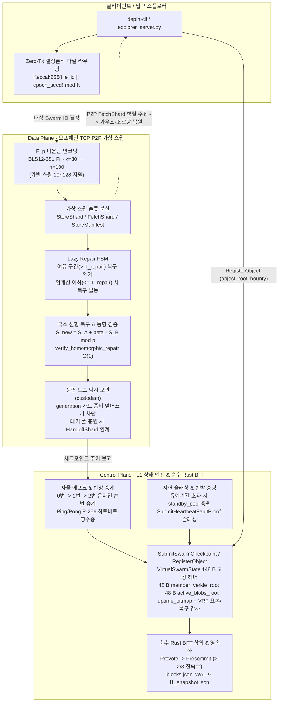
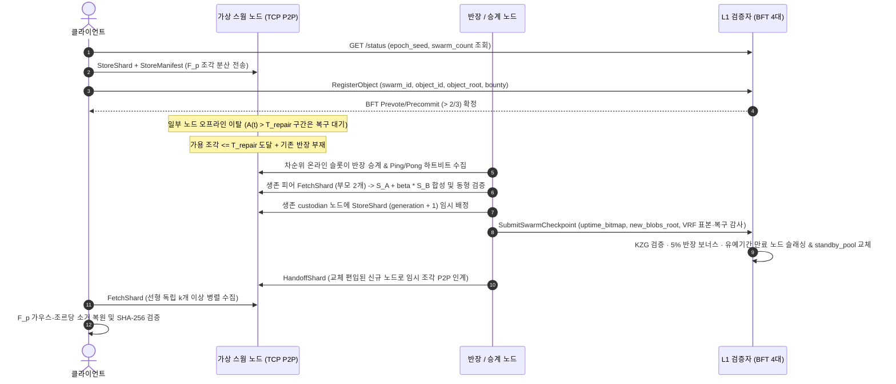

# DePIN Mobile Storage L1 (`depin-mobile-l1`)

고이탈률(High-Churn) 모바일 유휴 스토리지 환경을 위한 **가상 스웜(Virtual Swarm) 기반 L1 스토리지 프로토콜** 순수 Rust 구현체입니다.  
모바일 노드가 절전·네트워크 전환으로 일시 이탈했다 복귀할 때 발생하는 불필요한 재복제 트래픽을 **안전버퍼 지연 복구(Lazy Repair)** 와 **$\mathbb{F}_p$ 국소 선형 결합**으로 억제하고, **KZG 벡터 커밋먼트 + 148 B 고정 스웜 헤더 + 순수 Rust BFT**로 경량 정산합니다.

- **상세 구현 명세서**: [docs/implementation_spec.md](docs/implementation_spec.md)
- **로컬 데모 실행 가이드**: [docs/demo-quickstart.md](docs/demo-quickstart.md)

---

## 1. 전체 시스템 아키텍처

파일 바이트를 저장·복구하는 **Data Plane(TCP P2P 가상 스웜)** 과 멤버·루트·출석·보상을 확정하는 **Control Plane(L1 상태 엔진 & BFT)** 을 분리해 처리합니다.



---

## 2. 파일 수명주기 및 장애·복구 흐름



---

## 3. 핵심 설계 요소

| 계층 / 모듈 | 핵심 메커니즘 | 설명 |
| --- | --- | --- |
| **상태 압축** (`state_db.rs`) | `VirtualSwarmState` (148 B) | 슬롯별 개별 레코드(`89 B x 100 = 8,900 B`) 대신 멤버·데이터 48 B KZG 루트와 공통 필드만 온체인 커밋 (**고정 합의 헤더 98.3% 절감**) |
| **셔플·라우팅** (`shuffler.rs`) | VRF + 다양성 필터 + `route_file_to_swarm` | 서브넷·국가 편중 제한 및 가동률 우선 스웜 편성(가변 `10~128` 슬롯, 약 10% `standby_pool` 예비분), 해시 기반 Zero-Tx 파일 배정 |
| **소수체 코딩** (`fountain.rs`) | `BLS12-381 Fr` 선형 결합 | `31 B` 단위 필드 패킹, $k$개 소스 + $(n-k)$개 패리티 생성, 랭크($\text{rank} \ge k$) 검사 기반 가우스-조르당 디코딩 |
| **지연 복구** (`lazy_repair_fsm.rs`) | 안전버퍼 & `generation` 가드 | $A(t) > T_{\text{repair}}$ 구간에서 일시 이탈 복구 전송 억제, 임계선 도달 시 $T_{\text{target}}$까지 보충 후 세대 번호로 구노드 덮어쓰기 차단 |
| **동형 검증** (`verkle_kzg.rs`, `pollution_guard.rs`) | 2단계 32 B 지문 + 48 B KZG | `Commit(fp(S_A + beta*S_B)) == Commit(fp(S_A)) + beta*Commit(fp(S_B))` 타원곡선 점 연산으로 $O(1)$ 오염 탐지 |
| **정산·승계** (`executor.rs`, `swarm_coordinator.rs`) | 자율 에포크 & 반박 증명 | 차순위 반장 자동 승계 및 5% 보너스, 허위 결석 보고 시 `SubmitHeartbeatFaultProof` 슬래싱, 유예기간 초과 시 대기 풀 충원 |

---

## 4. 워크스페이스 구조

```text
depin-mobile-l1/
 ├── crates/
 │   ├── 1-l1-state-engine/      # VirtualSwarmState(148B), VRF 셔플러·라우팅, 정산/슬래싱 실행기, BFT 합의
 │   ├── 2-verkle-fountain/      # BLS12-381 Fr 파운틴 코딩, 국소 선형 복구, 2단계 지문 + KZG, 오염 탐지
 │   ├── 3-swarm-protocol/       # LazyRepairFsm, 체크포인트 조립기, 24h 이산 사건 Churn 시뮬레이터
 │   └── 4-node-network/         # TCP P2P 프레이밍, 디스크 스냅샷/WAL, L1·스토리지 데몬, 클라이언트
 ├── bin/
 │   ├── depin-node/             # 독립 실행 데몬 바이너리 (validator / storage 서브커맨드)
 │   ├── depin-cli/              # 클러스터 맵·노드 등록·업로드·에포크 사이클·인계·다운로드 CLI
 │   └── node-benchmark/         # 마이크로 벤치마크, 파라미터 스윕 및 통합 테스트 러너
 ├── scripts/
 │   ├── live_demo.sh            # 검증자 4대 + 스토리지 노드 10대 실 프로세스 장애·승계·복구 데모
 │   ├── check_validators.sh     # 검증자 /health 및 /status 높이·해시 일치 여부 검사 스크립트
 │   └── explorer_server.py      # 실시간 L1 블록·가상 스웜 웹 익스플로러 및 파일 업/다운로드 서버
 ├── results/                    # 24h Churn 비교 및 T_repair 스윕 CSV 결과
 └── docs/                       # 구현 명세서(implementation_spec.md) 및 데모 가이드(demo-quickstart.md)
```

---

## 5. 실측 벤치마크 및 시뮬레이션 결과

### 5.1 암호학·코딩 및 온체인 BFT 성능 ([docs/implementation_spec.md](docs/implementation_spec.md) 기준)

| 영역 | 측정 항목 | 실측 수치 |
| --- | --- | ---: |
| `2-verkle-fountain` (1 MB, $k=30, n=100$) | $\mathbb{F}_p$ 파운틴 인코딩 | `63.856 ms` |
| | 2단계 선형 지문 + 48 B KZG 루트 생성 | `6.045 ms` |
| | 로컬 $\mathbb{F}_p$ 선형 결합 복구 (1조각) | `0.021 ms` |
| | $O(1)$ 동형 오염 조각 검증 | `3.619 ms` |
| | 가우스-조르당 디코딩 (30조각) | `24.002 ms` |
| `1-l1-state-engine` (100슬롯 기준) | 스웜 고정 합의 헤더 크기 | **`148 B`** (기존 `8,900 B` 대비 **98.3% 절감**) |
| | 체크포인트 + 복구 감사 + 3/4 BFT 블록 확정 | `9.224 ms` |

### 5.2 24시간 모바일 Churn 시뮬레이션 ([results/churn_comparison.csv](results/churn_comparison.csv))

> 조건: 원본 100 MB · 24시간(10분 단위 144스텝) · 이탈 시 90% 확률 10~20분 뒤 복귀 · $T_{\text{repair}}=45$, `target=60` · 단일 시드 `42`  
> (비교군은 가용 조각 감소 시 즉시 복구하는 시뮬레이터 비교 모델 기준입니다.)

| 시간당 이탈률 | 3중 복제 모델 (`swarm_replication_proxy`) | RS 모델 (`storj_rs_proxy`) | 2D 모델 (`walrus_2d_proxy`) | **제안 모델 (`proposed_fp_lazy`)** | 제안 모델 생존 스텝 |
| :---: | ---: | ---: | ---: | ---: | :---: |
| **5%** | 0.559 GiB (3 tx) | 12.318 GiB (128 tx) | 4.371 GiB (128 tx) | **0.000 GiB (4 tx)** | 144 / 144 |
| **15%** | 1.304 GiB (7 tx) | 37.629 GiB (391 tx) | 13.352 GiB (391 tx) | **0.000 GiB (4 tx)** | 144 / 144 |
| **25%** | 3.539 GiB (19 tx) | 63.805 GiB (663 tx) | 22.640 GiB (663 tx) | **0.000 GiB (4 tx)** | 144 / 144 |
| **35%** | 4.843 GiB (26 tx) | 95.371 GiB (991 tx) | 33.841 GiB (991 tx) | **0.158 GiB (4 tx, -96.7% vs 3중 복제)** | 144 / 144 |
| **55%** | 11.548 GiB (62 tx) | 172.360 GiB (1,791 tx) | 61.160 GiB (1,791 tx) | **0.633 GiB (4 tx)** | 144 / 144 |

---

## 6. 빠른 실행 가이드 (Quickstart)

### 테스트 및 벤치마크

```bash
# 전체 워크스페이스 단위 · 통합 · 네트워크 E2E 테스트
cargo test --workspace

# 마이크로 벤치마크 및 24h Churn / T_repair 스윕 CSV 생성
cargo run --release --bin node-benchmark
```

### 14개 프로세스 로컬 장애·복구 데모 및 검증자 상태 점검

자세한 사전 준비, 단계별 로그 확인 및 트러블슈팅은 [로컬 데모 실행 가이드](docs/demo-quickstart.md)를 참고하세요.

```bash
# L1 검증자 4대 + 스토리지 노드 10대(100슬롯) 실 프로세스 업로드 -> 장애 -> 자율 승계·복구 -> WAL 재시작 -> 다운로드 검증
bash scripts/live_demo.sh

# 검증자 RPC(/health, /status) 블록 높이 및 해시 일치 검사
bash scripts/check_validators.sh http://127.0.0.1:19110 http://127.0.0.1:19111
```

### 실시간 블록·가상 스웜 웹 익스플로러

```bash
python3 scripts/explorer_server.py --port 19080
```
