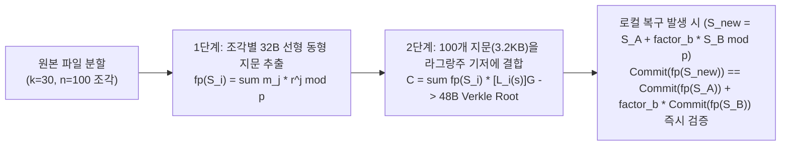
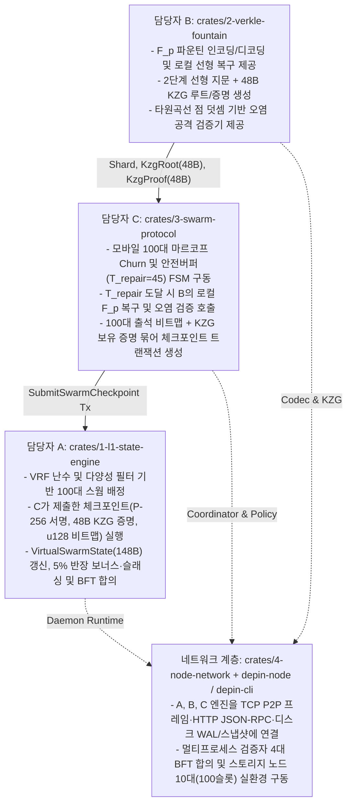
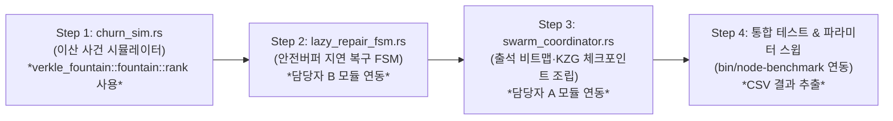
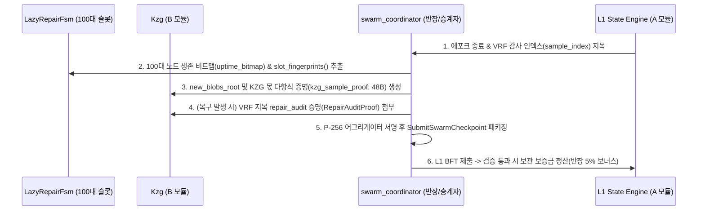

# DePIN 모바일 스토리지 L1 개발 및 구현 명세서

> 연관 문서: [[DePIN 모바일 스토리지 L1 심층 리서치]] | [[DePIN 모바일 스토리지 L1 리서치 계획서]] | [[DePIN 모바일 스토리지 L1 최종 명세]]

---

## 1. 개발 범위 및 검증 지표

상위 스마트 컨트랙트(Solidity) 계층의 오버헤드를 배제하고, 핵심 상태 전이(eSTF)와 암호학 검증을 순수 Rust 로우레벨 L1 실행 엔진에 직접 내장(Enshrine)하여 구현한다. 추가로 실제 멀티프로세스 TCP P2P · 디스크 영속 저장소 · HTTP JSON-RPC 계층(`4-node-network`)까지 구축해 단일 프로세스 시뮬레이션뿐 아니라 실제 분산 프로세스 장애 복구까지 검증한다.

| 검증 영역 | 검증 내용 | 비교 기준 (Baseline) | 측정 지표 (Metrics) |
| :--- | :--- | :--- | :--- |
| **1. 온체인 상태·합의 엔진**<br>(`1-l1-state-engine`) | 가상 스웜 상태 추상화(`VirtualSwarmState` 148B) 및 로우레벨 네이티브 실행기(P-256, KZG, 비트맵 정산, `>2/3` 순수 Rust BFT) 적용 시 상태 크기 및 실행 비용 절감률 측정 | 100대 노드의 개별 슬롯 레코드(`89B × 100 = 8,900B`)를 온체인에 각각 기록하고 이탈 시마다 갱신하는 구조 | - 스웜당 상태 크기 (Bytes)<br>- 체크포인트+BFT 블록 처리 레이턴시 (ms)<br>- 24시간 누적 온체인 트랜잭션 수 |
| **2. 코딩 및 암호학 코어**<br>(`2-verkle-fountain`) | $\mathbb{F}_p$(`BLS12-381 Fr`) 선형 파운틴 코딩, 로컬 선형 결합 복구, 2단계 선형 지문 + 라그랑주 KZG 동형 검증 결합 시 복구 속도 및 오염 공격(Pollution) 탐지 시간 측정 | 1세대 PoRep(실링) 및 2세대 1D Reed-Solomon 전체 디코딩 후 재인코딩 | - 인코딩/디코딩/로컬 복구 시간 (ms)<br>- 2단계 KZG 루트·증명 생성 시간 (ms)<br>- 동형 오염 조각 탐지 레이턴시 (ms) |
| **3. 스웜 프로토콜·시뮬레이터**<br>(`3-swarm-protocol`) | 안전버퍼 구간($T_{\text{repair}}$) 기반 지연 복구, `generation` 가드, 6시간 에포크 단위 출석 비트맵·KZG 보유 증명 집계 적용 시 복구 대역폭 절감률 측정 | - Ethereum Swarm (`swarm_replication_proxy`)<br>- Storj (`storj_rs_proxy`)<br>- Walrus (`walrus_2d_proxy`) | - 24시간 누적 복구 트래픽 (GB)<br>- 이탈률($5\%\sim55\%$) 및 $T_{\text{repair}}$별 데이터 생존율 |
| **4. 분산 노드 네트워크·영속성**<br>(`4-node-network`, `depin-node`, `depin-cli`) | 실제 멀티프로세스 TCP P2P 조각 전송·하트비트, 디스크 스냅샷/WAL, HTTP JSON-RPC, 검증자 BFT 합의 및 다중 노드 강제 종료(`kill -9`) 후 파일 복원 E2E 검증 | 인메모리 단일 프로세스 시뮬레이션 | - 실제 프로세스 간 BFT 합의·재시작 복구 성공 여부<br>- 생존 노드 TCP 조각 수집 및 SHA-256 원본 복원 일치 여부 |

---

## 2. 로우레벨 L1 아키텍처 구조 (Rust Cargo Workspace)

전체 프로젝트를 순수 Rust Cargo Workspace(`rustc 1.97.0`)로 구성한다. 코어 3개 크레이트(`1-l1-state-engine`, `2-verkle-fountain`, `3-swarm-protocol`) 위에 실제 분산 P2P·영속 DB·데몬 계층(`4-node-network`, `depin-node`, `depin-cli`)과 통합 벤치마크 러너(`node-benchmark`)를 결합한다.

```text
depin-mobile-l1/ (Pure Rust Cargo Workspace)
 ├── Cargo.toml
 ├── rust-toolchain.toml        # channel = "1.97.0"
 ├── crates/
 │   ├── 1-l1-state-engine/     # L1 네이티브 상태 머신(eSTF), VRF 셔플러, 정산/슬래싱, BFT 합의
 │   │   ├── src/state_db.rs
 │   │   ├── src/shuffler.rs
 │   │   ├── src/executor.rs
 │   │   └── src/consensus.rs
 │   │
 │   ├── 2-verkle-fountain/     # BLS12-381 F_p 파운틴 코딩 및 2단계 선형 지문 + Lagrange KZG 엔진
 │   │   ├── src/fountain.rs
 │   │   ├── src/verkle_kzg.rs
 │   │   └── src/pollution_guard.rs
 │   │
 │   ├── 3-swarm-protocol/      # 안전버퍼 FSM(generation 가드·임시보관), 반장 승계, 24h Churn 시뮬레이터
 │   │   ├── src/lazy_repair_fsm.rs
 │   │   ├── src/swarm_coordinator.rs
 │   │   └── src/churn_sim.rs
 │   │
 │   └── 4-node-network/        # [네트워크·영속성] TCP P2P 프레임, 디스크 스냅샷/WAL, L1/스토리지 데몬 & 클라이언트
 │       ├── src/wire.rs
 │       ├── src/persistence.rs
 │       ├── src/l1_daemon.rs
 │       ├── src/storage_daemon.rs
 │       ├── src/client.rs
 │       └── tests/network_e2e.rs
 │
 ├── bin/
 │   ├── node-benchmark/        # 3개 코어 영역 통합 벤치마크 및 E2E 테스트 (CSV 출력)
 │   │   ├── src/main.rs
 │   │   └── tests/integration.rs
 │   ├── depin-node/            # 실행형 데몬 바이너리 (`validator`, `storage`)
 │   │   └── src/main.rs
 │   └── depin-cli/             # 클러스터 초기화·업로드·에포크 사이클·다운로드 CLI
 │       └── src/main.rs
 │
 └── scripts/
     └── live_demo.sh           # 검증자 4대 + 스토리지 노드 10대(100슬롯) 실 프로세스 장애·복구 데모
```

---

## 3. 크레이트별 로우레벨 설계 및 인터페이스 명세

### 3.1 Crate 1: `1-l1-state-engine` (L1 상태 머신 및 정산 코어)

EVM 바이트코드 인터프리터를 거치지 않고 L1 노드 엔진 내부에서 직접 동작하는 상태 구조체와 네이티브 트랜잭션 실행기다. 복잡한 다운로드 영수증/트래픽 과금을 배제하고 **보관 보증금(Storage Bounty) + 에포크 출석·보유 증명 단일 정산 모델(Walrus 방식)**을 채택한다.

```rust
// crates/1-l1-state-engine/src/state_db.rs

pub const SWARM_SIZE: usize = 100;

/// L1 글로벌 상태 DB에 저장되는 가상 스웜 추상화 상태 객체 (고정 크기 148 Bytes)
pub struct VirtualSwarmState {
    pub swarm_id: u64,
    pub member_verkle_root: [u8; 48],  // 100대 모바일 노드 공개키(P-256) 및 지분 KZG 루트
    pub active_blobs_root: [u8; 48],   // 보관 중인 파일 조각들의 KZG 루트
    pub total_bond_balance: u128,      // 스웜 공동 스테이킹 담보금
    pub storage_bounty_pool: u128,     // 유저들이 예치한 보관 보상금(Bounty) 풀
    pub last_epoch_settled: u64,       // 마지막 정산 에포크 번호
    pub min_threshold_k: u16,          // 최소 복구 조각 수 (30)
    pub lazy_repair_trigger: u16,      // 지연 복구 발동 임계선 T_repair (45)
}

/// 지연 복구 발생 시 L1에 보고되는 복구 계보 엔트리
pub struct RepairEntry {
    pub repaired_slot: u8,         // 복구된 슬롯 번호 (0..99)
    pub parent_slot_a: u8,         // 로컬 결합에 사용된 부모 슬롯 A
    pub parent_slot_b: u8,         // 로컬 결합에 사용된 부모 슬롯 B
    pub factor_b: [u8; 32],        // S_new = S_A + factor_b * S_B (mod p) 결합 계수
}

pub struct RepairAuditProof {
    pub entry_index: usize,
    pub parent_a_eval: [u8; 32],
    pub parent_a_proof: [u8; 48],
    pub parent_b_eval: [u8; 32],
    pub parent_b_proof: [u8; 48],
    pub repaired_eval: [u8; 32],
    pub repaired_proof: [u8; 48],
}

pub enum NativeTransaction {
    RegisterMobileNode {
        pubkey_p256: [u8; 33],
        hw_attestation_sig: [u8; 64],
        ip_subnet_hash: u16,
        country_code: u8,
        stake: u128,
    },
    DepositStorageBounty {
        swarm_id: u64,
        amount: u128,
    },
    /// 6시간 에포크마다 스웜 어그리게이터(0번 슬롯 우선, 부재 시 차순위 승계)가 제출하는 체크포인트
    SubmitSwarmCheckpoint {
        swarm_id: u64,
        epoch: u64,
        aggregator_slot: u8,           // 제출자 슬롯 번호 (에포크 보상의 5% 보너스 수령)
        new_blobs_root: [u8; 48],      // 현재 스웜이 보관·복구 유지 중인 파일 조각들의 48B KZG 루트
        repair_log: Vec<RepairEntry>,  // 지연 복구 발생 시 기록되는 복구 계보 (평상시 빈 배열)
        uptime_bitmap: u128,           // 100대 노드 가동 출석부 비트맵 (1 bit = 1 node)
        sample_index: u8,              // L1 VRF가 랜덤 지목한 감사 대상 조각 인덱스 (0..99)
        sample_eval: [u8; 32],         // 해당 조각의 32B 지문(다항식 평가값)
        kzg_sample_proof: [u8; 48],    // 48B KZG 몫 다항식 인수정리 증명
        repair_audit: Option<RepairAuditProof>,
        aggregator_p256_sig: [u8; 64], // 스웜 어그리게이터의 TEE(P-256) 서명
    },
    /// 반장이 켜져 있던 노드를 결석(0)으로 허위 보고했을 때 피해 노드가 제출하는 반박 증거 (Fault Proof)
    SubmitHeartbeatFaultProof {
        swarm_id: u64,
        epoch: u64,
        node_slot: u8,
        aggregator_slot: u8,
        signed_pong_receipt: [u8; 64], // 에포크 내 반장이 서명해 준 생존 확인 영수증
    },
}
```

#### 핵심 구현 모듈 및 라우팅·정산 규칙
1. **`state_db.rs`**: 100대 노드를 개별 슬롯(`LegacySlotRecord` 89B × 100 = `8,900 Bytes`)에 저장하는 `LegacyStateDB`와 단일 `VirtualSwarmState`(`148 Bytes`, **98.3% 절감**)로 압축 저장하는 `EnshrinedSwarmDB` 구현.
2. **`shuffler.rs` (스웜 편성 및 파일별 결정론적 자동 라우팅)**:
   - **스웜 풀 편성:** 에포크 블록 헤더의 VRF 난수($R_{\text{epoch}}$)를 입력받아 $\text{Keccak256}(\text{NodeID} \parallel R_{\text{epoch}})$ 순으로 노드를 정렬하고, 다양성 제약(동일 IP 서브넷 $\le 2$대, 동일 국가 코드 $\le 25$대)을 적용해 $N$개의 가상 스웜(`Swarm #0 ~ #N-1`)을 편성.
   - **파일별 스웜 자동 배정:** `route_file_to_swarm`이 $\text{Target\_Swarm} = \text{Keccak256}(\text{File\_ID} \parallel R_{\text{epoch}}) \pmod N$ 공식으로 온체인 Tx 없이 담당 스웜을 결정론적으로 라우팅.
3. **`executor.rs` (보유·복구 증명 검증, 반장 인센티브 및 출석 반박 슬래싱)**:
   - **반장 순번 승계 및 보너스(5%):** 0번 슬롯 노드가 기본 어그리게이터이나, 오프라인일 경우 차순위(1번, 2번...) 온라인 노드가 제출하고 에포크 보상의 5%를 수령한다.
   - **복구 후 루트 교체 검증 (`repair_log` + VRF 1개 랜덤 감사):** 지연 복구로 `new_blobs_root`가 변경된 경우, `repair_log` 중 VRF가 지목한 슬롯 1개에 대해 부모 조각 2개(`old_root` 기준 KZG 검증)와 새 조각(`new_root` 기준 KZG 검증 및 `new_eval == a_eval + factor_b * b_eval`·G1 점 덧셈 일치)을 확인하여 $O(1)$ 비용으로 루트 교체를 승인한다.
   - **낙관적 출석 정산 및 Heartbeat Fault Proof:** 평소에는 반장 서명 1개로 `uptime_bitmap`을 즉시 정산하되, 반장이 온라인 노드를 `0(결석)`으로 조작하면 피해 노드가 `SubmitHeartbeatFaultProof`를 제출해 반장의 담보금을 즉시 슬래싱하고 보상을 회수한다.
4. **`consensus.rs` (순수 Rust 2/3 정족수 BFT 합의 엔진)**:
   - 상시 가동 검증자 집합의 P-256 `Prevote` / `Precommit` 서명을 집계해 전체 투표력의 `> 2/3` 정족수 달성 시 `BlockHeader`·`FinalizedBlock`과 `compute_state_root`를 원자적으로 확정한다.

---

### 3.2 Crate 2: `2-verkle-fountain` (소수체 파운틴 코딩 및 Verkle/동형 검증 코어)

대용량 파일을 분할·복구하고, KZG 스칼라 필드와 대수적으로 일치시킨 **$\mathbb{F}_p$ 소수체 선형 결합(Field-Aligned Fountain Coding)**을 통해 로컬 복구 무결성을 검증하는 암호학 모듈이다.



#### 핵심 구현 모듈
1. **`fountain.rs` ($\mathbb{F}_p$ 파운틴 인코딩, 로컬 선형 결합 복구 및 가우스-조르당 디코딩)**
   - 원본 데이터를 `BYTES_PER_SCALAR = 31` 단위로 오버플로우 없이 `BLS12-381 Fr` 스칼라로 패킹하고, $k=30$개 소스 조각 + $(n-k)$개 $\mathbb{F}_p$ 선형 결합 패리티 조각($n=100$)으로 분할 인코딩(`encode`).
   - `repair_local_field(a: &Shard, b: &Shard, factor_b: Scalar) -> Result<Shard>`: 원본 디코딩 없이 살아남은 조각 2개의 스칼라 블록들을 $S_{\text{new}} = S_A + \text{factor\_b} \cdot S_B \pmod p$로 모듈러 연산하여 신규 패리티 조각 즉석 생성.
   - `try_insert_pivot` / `rank` / `decode`: 선도 열(pivot column) 인덱싱 기반 $\mathbb{F}_p$ 가우스-조르당 소거법으로 $k$개 이상의 선형 독립 조각에서 원본 바이트 및 SHA-256 무결성 검증 복원.
2. **`verkle_kzg.rs` (2단계 선형 지문 + KZG 다항식 커밋먼트 및 SRS 영속화)**
   - **1단계 (Linear Homomorphic Fingerprint):** 각 조각 $S_i$의 스칼라 벡터를 호너법(Horner's method) 다항식 평가($fp(S_i) = \sum m_{i,j} r^j \pmod p$)하여 조각당 32B 지문 추출.
   - **2단계 (KZG Verkle Root):** 100개 조각의 지문 $(0, fp_0), \dots, (99, fp_{99})$ (총 3.2KB)을 뉴턴 보간 + BLS12-381 MSM(`ark-bls12-381 0.5.0`)으로 커밋하여 48B 루트 $C = [P(s)]G$ 및 몫 다항식 오프닝 증명 $\pi_i = [Q(s)]G$ 생성. 분산 노드 디스크 공유를 위해 `to_bytes` / `from_bytes` 직렬화도 제공.
3. **`pollution_guard.rs` (비잔틴 오염 공격 $O(1)$ 타원곡선 점 덧셈 검증)**
   - $\mathbb{F}_p$ 선형 동형성에 의해 $\text{Commit}(S_A + \text{factor\_b} \cdot S_B \pmod p) == \text{Commit}(S_A) + \text{factor\_b} \cdot \text{Commit}(S_B)$ 등식이 대수적으로 100% 성립.
   - `verify_homomorphic_repair`로 원본 파일 데이터 다운로드 없이 48B 타원곡선 점 연산(릴리즈 실측 `3.619 ms`)으로 위조·오염 조각을 즉각 색출.

---

### 3.3 Crate 3: `3-swarm-protocol` (스웜 프로토콜 및 Churn 시뮬레이터)

모바일 노드 100대로 구성된 스웜의 상태 전이(안전버퍼 및 지연 복구 트리거), 에포크 출석/KZG 보유 증명 조립, 그리고 24시간 이탈 시뮬레이션을 담당하는 모듈이다.

#### 핵심 구현 모듈
1. **`lazy_repair_fsm.rs` (안전버퍼 및 지연 복구 상태 머신)**
   - 스웜 내 100대 노드의 상태(`Online`, `TransientOffline(복귀 타이머)`, `Dead`) 관리.
   - 활성 조각 수 $A(t)$가 안전버퍼 구간($45 < A(t) \le 100$)에 있을 때는 복구 트래픽을 0으로 억제(Suppress).
   - $A(t) \le T_{\text{repair}}(45)$ 도달 시 `2-verkle-fountain`의 `repair_local_field`와 `pollution_guard`를 호출하여 새 조각 15개를 생성·검증하고 안전선(60개)으로 복구.
   - **에포크 내 임시 보관 & 에포크 전환 시 충원:** 지연 복구로 생성된 15개 신규 조각은 복구가 터진 해당 에포크 동안 살아있는 노드들이 임시 분담 보관하여 즉각 가용성을 유지하고, 6시간 에포크 종료 시 L1 대기 풀(`Standby Pool`)의 신규 노드를 정식 슬롯에 채워 넣음.
2. **`swarm_coordinator.rs` (에포크 출석 집계 및 체크포인트 조립기)**
   - **다운로드 무료화 (단일 보관료 모델):** 유저가 업로드 시 L1에 보관 보증금(`storage_bounty_pool`)을 예치하면, 다운로드는 별도 영수증 핑퐁 없이 온라인 노드들이 30개 조각을 병렬 전송한다.
   - **에포크 체크포인트 생성:** 에포크 종료(6시간) 시 어그리게이터 노드가 `LazyRepairFsm`의 100대 가동 출석부(`uptime_bitmap: u128`), 갱신된 KZG 루트(`new_blobs_root`), 그리고 L1 VRF가 지목한 감사 조각(`sample_index`)의 KZG 증명을 수집해 `1-l1-state-engine`에 제출할 단일 `SubmitSwarmCheckpoint` 트랜잭션으로 패키징.
3. **`churn_sim.rs` (이산 사건 Churn 시뮬레이터)**
   - 24시간(10분 단위 144스텝) 동안 시간당 이탈률($p = 5\% \sim 55\%$, 일시적 이탈 복귀율 90%) 환경에서 4가지 방식(`Ethereum Swarm 즉시 복제`, `Storj 1D RS`, `Walrus 정적 위원회`, `제안 방식`)을 동시 구동하여 누적 복구 트래픽(GB), 온체인 Tx 수, 데이터 생존율을 CSV 및 그래프로 출력.

---

### 3.4 Crate 4: `4-node-network` (분산 TCP P2P · 디스크 영속성 · RPC 데몬 계층)

인메모리 코어 크레이트 1~3을 실제 **멀티프로세스 TCP 네트워크와 디스크 파일 시스템 위에서 구동 가능한 블록체인·스토리지 인프라**로 확장한 계층이다. 이름의 `4-`는 "노드 4대"라는 의미가 아니라 코어 3개 크레이트(`1-l1-state-engine`, `2-verkle-fountain`, `3-swarm-protocol`)에 이어 **4번째 계층 크레이트**임을 뜻하는 워크스페이스 번호 규칙이다.

#### 핵심 구현 모듈
1. **`wire.rs` (TCP P2P 바이너리 프레이밍 & HTTP/1.1 JSON-RPC 공용 엔진)**
   - `tokio::net::TcpStream` 위 4바이트 빅엔디안 길이 접두어 + JSON 프레임 기반 P2P 프로토콜(`Ping`/`Pong`, `StoreShard`, `FetchShard`, `StoreManifest`, `BftPropose`/`BftVoteReply`, `BftCommit`)과 DTO(`ShardDto`, `TxDto`, `SwarmClusterMapDto`, `SwarmManifestDto`, `CycleReportDto`) 구현.
   - 경량 HTTP/1.1 파서·응답기(`read_http_request`, `write_http_json`) 및 공용 TCP 수락 루프(`spawn_tcp_server`) 제공.
2. **`persistence.rs` (디스크 스냅샷/WAL 및 슬롯 조각 영속 저장소)**
   - `AttestationProvider` / `SoftwareTeeKey` & `load_or_create_signing_key`: 노드/검증자 P-256 개인키를 디스크(`validator_key.hex`, `keys/slot_<n>.hex`)에 영속 저장·로드.
   - `ValidatorStorage`: `kzg_srs.bin`, 원자적 상태 스냅샷 `l1_snapshot.json`, 블록 WAL `blocks.jsonl` 저장 및 프로세스 재시작 시 BFT 높이·상태 DB 복구.
   - `NodeStorage`: 슬롯별 조각(`slot_<n>_shard_<obj>.json`), 임시 보관 조각(`custodian_slot_<n>_...`), 세대 가드 메타데이터(`slot_<n>_meta.json`), 스웜 매니페스트(`swarm_manifest.json`)를 디스크에 원자적으로 기록하고, `generation`이 낮은 좀비 덮어쓰기를 디스크 단에서 차단.
3. **`l1_daemon.rs` (분산 L1 검증자 노드 데몬)**
   - HTTP JSON-RPC(`GET /health`, `GET /status`, `POST /tx/submit`, `POST /tx/batch`, `POST /swarm/init`)로 트랜잭션을 수락하고, 피어 검증자들에게 TCP `BftPropose`를 전파하여 각 검증자가 독립 실행·`state_root` 대조 후 `Prevote`/`Precommit` 서명을 회신하게 한다.
   - `> 2/3` 정족수 달성 시 `BftCommit` 브로드캐스트와 동시에 `l1_snapshot.json` 및 `blocks.jsonl`에 영속 반영(검증자 4대 중 1대 다운 시에도 3/4 정족수로 정상 합의 지속).
4. **`storage_daemon.rs` (모바일 스웜 스토리지 노드 데몬)**
   - 하나 이상의 가상 슬롯을 호스팅하며 P2P `Ping`(P-256 생존 서명 `Pong` 응답), `StoreShard`, `FetchShard`, `StoreManifest`를 처리.
   - `POST /aggregator/run_cycle` 호출 시 `JoinSet`으로 100슬롯 병렬 TCP `Ping` 수행 -> `0번` 부재 시 최선순위 생존 슬롯으로 반장 자동 승계 -> 가용 조각 $\le T_{\text{repair}}(45)$이면 생존 피어로부터 TCP `FetchShard`로 부모 조각을 받아 `repair_local_field` + `verify_homomorphic_repair` 수행 -> 생존 custodian 노드에 TCP `StoreShard` 배분 -> 새 KZG 루트·VRF 감사 증명 조립 후 L1 BFT 체크포인트 제출 및 매니페스트 동기화.
5. **`client.rs` 및 실행 바이너리 (`bin/depin-node`, `bin/depin-cli`, `scripts/live_demo.sh`)**
   - `depin-node`: `validator`, `storage` 서브커맨드를 제공하는 독립 OS 데몬 바이너리.
   - `depin-cli`: `gen-cluster-map`, `status`, `register-all`, `upload`, `run-cycle`, `download` 서브커맨드 제공.
   - `scripts/live_demo.sh`: 실제 14개 OS 프로세스(검증자 4대 + 스토리지 노드 10대, 100슬롯)를 기동해 업로드 -> 6대 노드(60슬롯) 및 검증자 1대 `kill -9` -> 차순위 승계·지연 복구·3/4 BFT 확정 -> 검증자 재시작 복구 -> 생존 노드 TCP 다운로드 및 SHA-256 일치를 자동 시연한다.

---

## 4. 3인 + 네트워크 확장 R&R 및 모듈 연동 구조

핵심 3명의 개발자가 코어 크레이트 1개씩을 전담하고, 4번째 계층(`4-node-network`)은 코어 크레이트들의 공개 API 위에서 분산 네트워크·영속성 계층으로 조립된다.



### 담당자별 작업 요약표

| 구분 | 담당자 A (`1-l1-state-engine`) | 담당자 B (`2-verkle-fountain`) | 담당자 C (`3-swarm-protocol`) | 네트워크 인프라 (`4-node-network`) |
| :--- | :--- | :--- | :--- | :--- |
| **핵심 도메인** | 블록체인 상태 머신(eSTF), 정산 및 순수 Rust BFT 합의 | $\mathbb{F}_p$ 파운틴 코딩 및 Verkle(KZG) 암호학 | 분산 스웜 프로토콜 및 Churn 시뮬레이터 | TCP P2P, 디스크 WAL/스냅샷, HTTP JSON-RPC 데몬 & CLI |
| **주요 사용 크레이트** | `p256`, `sha3`, `sha2`, `thiserror` | `ark-bls12-381`, `ark-ff`, `ark-ec`, `ark-poly`, `ark-serialize`, `sha2` | `rand`, `rand_chacha`, `serde`, `csv` | `tokio`, `serde_json`, `clap`, `hex`, `p256`, `sha2` |
| **구현할 핵심 파일** | 1. `state_db.rs`<br>2. `shuffler.rs`<br>3. `executor.rs`<br>4. `consensus.rs` | 1. `fountain.rs`<br>2. `verkle_kzg.rs`<br>3. `pollution_guard.rs` | 1. `lazy_repair_fsm.rs`<br>2. `swarm_coordinator.rs`<br>3. `churn_sim.rs` | 1. `wire.rs` & `client.rs`<br>2. `persistence.rs`<br>3. `l1_daemon.rs` & `storage_daemon.rs`<br>4. `depin-node` & `depin-cli` |
| **추출할 벤치마크 지표** | - 상태 DB 크기 (`8,900B` vs `148B`)<br>- 체크포인트+복구감사+3/4 BFT 블록 시간 (ms) | - 인코딩/디코딩/로컬 $\mathbb{F}_p$ 복구 속도 (ms)<br>- 2단계 지문+KZG 루트 생성 및 오염 검증 시간 (ms) | - 시간당 이탈률($5\%\sim55\%$)별 24시간 누적 복구 트래픽 (GB)<br>- 온체인 Tx 수 및 $T_{\text{repair}}$ 스윕 곡선 | - 14개 실 프로세스 E2E 장애·승계·재시작 복구 및 SHA-256 일치 검증 |

---

## 5. [담당자 C 상세 가이드] `3-swarm-protocol` 착수 순서 및 모듈별 구현 명세

담당자 C가 맡은 `crates/3-swarm-protocol`은 **모바일 노드 100대의 오프라인 이탈과 복귀를 관리하는 컨트롤 플레인(Control Plane)**이자, 담당자 B의 암호학·코딩 모듈(`2-verkle-fountain`)과 담당자 A의 온체인 상태 엔진(`1-l1-state-engine`)을 하나로 엮어 **학술적 실험 지표(복구 트래픽 절감률, 데이터 생존율)를 뽑아내는 핵심 크레이트**다.

---

### 5.1 어떤 순서로 시작해야 하는가? (착수 로드맵)

`3-swarm-protocol`은 A와 B의 크레이트를 모두 참조(`Cargo.toml` 의존성 보유)하지만, **구현 및 코드 분석은 의존성이 가장 적은 파일부터 역순으로 진행**하는 것이 가장 빠르다.



| 단계 | 작업 대상 파일 | 선행 조건 (팀원 의존성) | 핵심 목표 |
| :---: | :--- | :--- | :--- |
| **Step 1** | `src/churn_sim.rs` | `verkle_fountain::fountain::rank` 및 `Scalar` 사용 | 24시간(144스텝) 동안 모바일 이탈률($5\%\sim55\%$)에 따른 4가지 스토리지 모델의 복구 대역폭과 생존율을 시뮬레이션으로 검증 |
| **Step 2** | `src/lazy_repair_fsm.rs` | 담당자 B의 `Shard`, `repair_local_field`, `verify_homomorphic_repair`, `Kzg` | 실제 $\mathbb{F}_p$ 스칼라 데이터가 담긴 100개 슬롯의 상태 전이(`Online` / `TransientOffline` / `Dead`), `custodian_slot` 임시 보관 및 $T_{\text{repair}}=45$ 도달 시 원자적 로컬 복구 구현 |
| **Step 3** | `src/swarm_coordinator.rs` | 담당자 A의 `SubmitSwarmCheckpoint` 및 `p256` 서명 | 100대 출석부(`uptime_bitmap`), 반장 자동 승계(`select_active_aggregator`), 갱신된 KZG 루트, VRF 감사 샘플·복구 계보 감사를 수집해 L1 제출용 체크포인트 트랜잭션 조립 |
| **Step 4** | `tests/integration.rs` & 실험 확장 | A, B, C 전체 모듈 | 비정상 케이스(오염 조각, 거짓 출석, 좀비 복귀 노드, 지연 슬래싱) 방어 검증 및 $T_{\text{repair}}$ 임계값 스윕 데이터 추출 |

---

### 5.2 Step 1 상세: 이산 사건 Churn 시뮬레이터 (`src/churn_sim.rs`)

가장 먼저 코드를 읽고 실험 파라미터를 다뤄봐야 할 파일이다. 실제 대용량 페이로드 암호학 연산 없이 **$\mathbb{F}_p$ 계수 벡터(`coeff: Vec<Scalar>`)와 선형 결합만으로 24시간 네트워크 거동을 빠르게 모사**한다.

#### 1) 핵심 설계 포인트
- **공정한 비교를 위한 난수 스트림 분리 (Paired RNG):**
  - 4가지 비교 대상(`Replication`, `ReedSolomon`, `WalrusProxy`, `Proposed`)이 **정확히 동일한 시점에 동일한 노드가 꺼지는 사건**을 겪어야 비교가 공정하다.
  - 이를 위해 코딩 계수 생성용 RNG(`rng`)와 이탈 이벤트 발생용 RNG(`events = ChaCha8Rng::seed_from_u64(seed ^ 0x6576_656e_7473)`)를 분리하여 매 스텝마다 고정된 100개의 난수 튜플 `(이탈 확률, 복귀 여부 확률, 오프라인 지속 스텝 1~2)`를 뽑는다.
- **단순 조각 개수가 아닌 '선형 독립 랭크(`rank`)' 기반 생존 판정:**
  - 살아있는 조각이 30개여도 서로 선형 종속이면 원본 파일을 복원할 수 없다.
  - 따라서 각 노드가 보유한 `Vec<Scalar>` 계수 벡터들의 $\mathbb{F}_p$ 가우스 소거법 랭크(`rank()`)를 계산하여 **`stored_rank < k(30)`이면 영구 데이터 유실(`lost = true`)**, **`online_rank >= k(30)`이면 즉시 다운로드 가능(`available = true`)**으로 판정한다.

#### 2) 타임스텝(10분 단위, 총 144스텝 = 24시간) 동작 흐름
1. **스텝당 이탈 확률 변환:** 시간당 이탈률 $p_{\text{hourly}}$를 10분 단위 이탈 확률 $p_{\text{step}} = 1 - (1 - p_{\text{hourly}})^{10/60}$으로 변환한다.
2. **복귀 및 이탈 처리:**
   - `Status::TransientOffline(return_step)` 상태인 노드는 `return_step <= step`이 되면 원래 계수(`coeff`)를 그대로 들고 `Status::Online`으로 복귀한다 (트래픽 소모 0).
   - `Status::Online` 노드가 $p_{\text{step}}$ 확률로 이탈할 때, `return_probability`(기본 90%) 확률로 1~2스텝(10~20분) 뒤 복귀하는 `TransientOffline`이 되고, 나머지 10% 확률로 영구 이탈(`Status::Dead`, `coeff.fill(0)`)한다.
3. **복구 트리거 및 대역폭 비용 누적:**
   - **기존 방식 (`Replication`, `ReedSolomon`, `WalrusProxy`):** `active < n` (1대라도 꺼짐) 즉시 `n`개까지 복구를 발동하며, 복구할 때마다 온체인 트랜잭션(`tx += 1`)과 각 방식별 읽기 비용(RS는 $k=30$개 조각 읽기, WalrusProxy는 10개 읽기 등)이 누적된다.
   - **제안 방식 (`Proposed`):** `active <= trigger(45)`일 때만 발동하여 `target(60)`개까지만 채운다. `Dead` 슬롯을 최우선으로 보충하고(`TransientOffline` 보존), 살아있는 부모 쌍을 라운드로빈과 가변 $\beta$로 $\mathbb{F}_p$ 선형 결합(`*ca + beta * *cb`)하여 조각 2개 읽기 비용(`read_count = 2`)만 부과한다. 온체인 트랜잭션은 6시간(360분)마다 단 1회(`tx += 1`)만 발생한다.

---

### 5.3 Step 2 상세: 안전버퍼 및 지연 복구 FSM (`src/lazy_repair_fsm.rs`)

시뮬레이터(`churn_sim.rs`)가 수식 모델이라면, `lazy_repair_fsm.rs`는 **실제 바이트 배열이 들어있는 `Shard` 구조체와 KZG 암호학 증명을 다루는 프로토콜 상태 머신**이다.

#### 1) 핵심 데이터 구조
```rust
pub enum NodeState {
    Online,
    TransientOffline { return_at: u64 }, // 일시 이탈 (복귀 예정 시각 기록, Shard 유지)
    Dead,                                // 영구 이탈 (Shard 즉시 폐기: None)
}

pub struct Slot {
    pub state: NodeState,
    pub generation: u64,                 // 슬롯 교체 세대 번호 (Zombie 복귀 방지용)
    pub shard: Option<Shard>,
    pub custodian_slot: Option<usize>,   // 같은 에포크 내 임시 보관 책임을 맡은 생존 노드 슬롯 인덱스
}
```

#### 2) 왜 `generation`(세대 번호) 가드가 필요한가?
- 모바일 노드 0번이 지하철에서 오프라인(`TransientOffline`, `generation = 0`)이 되었다고 가정하자.
- 그사이 스웜 전체 활성 조각이 45개 이하로 떨어져 지연 복구(`repair()`)가 발동되었고, 0번 슬롯에 새 패리티 조각과 임시 보관 노드(`custodian_slot`)가 배정되면서 `generation = 1`로 증가했다.
- 뒤늦게 지하철에서 나온 옛날 0번 노드가 `return_node(index: 0, generation: 0, now)`를 호출하더라도, 현재 슬롯의 `generation(1)`과 다르므로 **`Ok(false)`로 무시하여 새로 복구된 조각이 덮어써지는 참사를 막는다.**

#### 3) 원자적(Atomic) 로컬 복구 (`repair` 함수) 구현 원리
1. **안전버퍼 체크:** `self.active_shard_count() > self.trigger(45)`이면 아무 작업도 하지 않고 `Ok(Vec::new())`를 반환한다.
2. **복구 가능성(Rank) 체크:** `self.online_rank() < self.k(30)`이면 이미 독립 조각이 부족해 복원이 불가능하므로 `Err(Error::Unavailable)`를 반환한다.
3. **후보 조각 합성 및 동형 오염 검증 루프:**
   - 접근 가능한 두 부모 조각 `(ia, a)`와 `(ib, b)`를 순회하며 `repair_local_field(a, b, factor_b)`를 호출해 후보 조각 `candidate`를 생성한다.
   - `verify_homomorphic_repair(kzg, root, auth_a, auth_b, factor_b, &candidate)`를 호출하여 부모 조각 $a, b$가 KZG 루트에 등록된 진짜 조각인지, 그리고 `candidate`의 48B KZG 지문 커밋먼트가 $\text{Commit}(fp(A)) + \text{factor\_b} \cdot \text{Commit}(fp(B))$와 일치하는지 $O(1)$ 검증한다.
4. **원자적 상태 반영 (Staging):**
   - 필요한 개수(`needed = target(60) - active`)만큼 후보가 모두 모이고 검증을 통과할 때까지 원본 `self`를 건드리지 않고, `staged = self.clone()` 복사본의 대상 슬롯을 갱신(`generation += 1`, `custodian_slot` 배정)한 뒤 마지막에 `*self = staged`로 한 번에 교체한다.

---

### 5.4 Step 3 상세: 에포크 코디네이터 및 체크포인트 조립기 (`src/swarm_coordinator.rs`)

다운로드 1MB 영수증 핑퐁을 제거하고 **보관 보증금(Storage Bounty) 단일 정산 모델**을 따르므로, 이 모듈은 **에포크 종료 시 반장 순번 승계(`select_active_aggregator`)와 스웜의 생존 출석부·KZG 보유 증명을 취합해 L1에 1건의 체크포인트 트랜잭션으로 보고하는 역할**에 집중한다.

#### 1) 에포크 체크포인트 조립 흐름 (`swarm_coordinator`)


#### 2) 핵심 구현 및 완료 항목 점검
- **`uptime_bitmap: u128` 추출 (`LazyRepairFsm::uptime_bitmap`)**: `구현 완료`
- **$T_{\text{repair}}$ 파라미터 스윕 실험 (`sweep_trigger_thresholds`)**: `구현 완료` (`results/threshold_sweep.csv` 생성)
- **복구 계보·KZG 루트 갱신·임시 보관 연계 (`slot_fingerprints`, `RepairAuditProof`, `finalize_standby_replacements`, `SwarmManifestDto`)**: `구현 완료`

---

## 6. 구현 검증 및 실측 벤치마크 결과

프로젝트 루트(`/Users/rpcos/Desktop/p/depin-mobile-l1`)에서 전체 테스트, 통합 벤치마크, 그리고 실제 14개 OS 프로세스 라이브 데모를 실행하여 아래 수치를 확인하였다.

### 6.1 실행 명령어

```bash
# 1. 전체 워크스페이스 단위 · 통합 · 네트워크 E2E 테스트 (41건)
cargo test --workspace

# 2. 3개 코어 영역 통합 벤치마크 및 CSV 출력 (results/churn_comparison.csv, threshold_sweep.csv)
cargo run --release --bin node-benchmark

# 3. 실제 14개 OS 프로세스(L1 검증자 4대 + 스토리지 노드 10대) 장애·복구 라이브 데모
bash scripts/live_demo.sh
```

### 6.2 테스트 검증 결과 (`cargo test --workspace`)
- **컴파일 경고 0건, 총 41건 전부 통과 (0 failed)**:
  - `l1-state-engine` (12 passed):
    - `state_db`: `legacy_vs_enshrined_state_size_compression`, `checkpoint_signing_bytes_is_deterministic_and_sensitive_to_fields`
    - `shuffler`: `shuffle_enforces_diversity_and_determinism`, `shuffle_spills_excess_same_subnet_or_country_to_standby_pool`, `shuffle_rejects_zero_config_and_route_rejects_zero_swarms`
    - `executor`: `register_node_rejects_under_min_stake_duplicate_and_bad_signature`, `init_swarm_and_deposit_bounty_validate_roster_and_amounts`, `checkpoint_rejects_wrong_epoch_offline_aggregator_and_bad_vrf_sample`, `heartbeat_fault_proof_rejects_online_slot_duplicate_claim_and_expired_window`
    - `consensus`: `bft_requires_more_than_two_thirds_quorum`, `bft_rejects_empty_validator_set_and_unregistered_proposer`, `bft_ignores_duplicate_votes_wrong_phase_and_bad_signatures`
  - `verkle-fountain` (11 passed):
    - `fountain`: `encode_local_field_repair_and_decode_boundary_lengths`, `encode_and_shard_validate_reject_invalid_parameters`, `decode_fails_with_insufficient_rank_on_linearly_dependent_shards`, `decode_detects_corrupted_symbol_via_sha256_object_id`, `repair_local_field_rejects_zero_factor_and_mismatched_metadata`
    - `verkle_kzg`: `kzg_commit_open_verify_and_homomorphism`, `kzg_srs_serialization_roundtrip_and_corrupted_bytes_error`, `scalar_and_g1_serialization_roundtrip_and_bounds`
    - `pollution_guard`: `catches_polluted_repair_shard_while_accepting_valid_field_repair`, `rejects_mismatched_coefficients_even_if_symbols_untouched`, `rejects_zero_factor_or_forged_parent_kzg_proof`
  - `swarm-protocol` (8 passed):
    - `lazy_repair_fsm`: `fsm_rejects_invalid_thresholds_and_tracks_transient_return`, `fsm_repair_fails_when_online_rank_falls_below_k`, `fsm_custodian_keeps_repaired_shard_accessible_until_standby_finalized`
    - `swarm_coordinator`: `select_active_aggregator_succeeds_in_order_and_fails_when_all_offline`, `build_checkpoint_rejects_offline_or_out_of_range_aggregator`
    - `churn_sim`: `churn_sim_paired_rng_determinism_and_epoch_tx_bound`, `churn_sim_rejects_invalid_parameters`, `sweep_trigger_thresholds_and_csv_export`
  - `node-network` 단위 · 네트워크 E2E 테스트 (6 passed = unit 5 + network_e2e 1):
    - `wire`: `shard_dto_and_tx_dto_roundtrip_all_variants`, `decode_fixed_hex_rejects_bad_length_and_invalid_hex`, `p2p_frame_and_http_json_loopback_over_tcp`
    - `persistence`: `signing_key_and_validator_snapshot_persistence_roundtrip`, `node_storage_shard_custodian_and_generation_guard`
    - `network_e2e`: `distributed_bft_lazy_repair_crash_recovery_and_download_e2e`
  - `node-benchmark` 통합 테스트 (4 passed):
    - `e2e_lifecycle_safe_buffer_repair_successor_bft_settlement_and_decode`, `zombie_node_generation_guard_prevents_stale_overwrite`, `rejects_fraudulent_root_swap_and_slashes_dishonest_aggregator_heartbeat`, `delayed_slashing_triggers_after_grace_period_and_replaces_from_standby`

### 6.3 실측 벤치마크 수치 (`cargo run --release --bin node-benchmark`)

#### [Area 1] `2-verkle-fountain` (1MB Payload, $k=30, n=100$)
| Metric | Value |
| :--- | ---: |
| $\mathbb{F}_p$ Fountain Encode ($k=30, n=100$) | 63.856 ms |
| 2-Stage Fingerprint + 48B KZG Root | 6.045 ms |
| Local $\mathbb{F}_p$ Linear Repair (1 shard) | 0.021 ms |
| Homomorphic Pollution Verification | 3.619 ms |
| Gaussian-Jordan Decode (30 shards) | 24.002 ms |

#### [Area 2] `1-l1-state-engine` (Virtual Swarm 상태 압축 & Pure Rust BFT)
| Metric | Legacy Individual Slot DB | Proposed Virtual Swarm L1 |
| :--- | ---: | ---: |
| On-chain State Size per Swarm (100 nodes) | 8,900 Bytes | **148 Bytes (98.3% 절감)** |
| Checkpoint + Repair Audit + 3/4 BFT Block Time | N/A | **9.224 ms** |

#### [Area 3] `3-swarm-protocol` (24h Churn Simulation, 100MB, `return_prob=90%`, $T_{\text{repair}}=45$, `target=60`)
| Churn Rate | Method | 24h Onchain Tx | Repair Read (GB) | Repair Write (GB) | Survived |
| :---: | :--- | ---: | ---: | ---: | :---: |
| 5% | `swarm_replication_proxy` / `storj_rs_proxy` / `walrus_2d_proxy` / **`proposed_fp_lazy`** | 3 / 128 / 128 / **4** | 0.28 / 11.92 / 3.97 / **0.00** | 0.28 / 0.40 / 0.40 / **0.00** | YES |
| 15% | `swarm_replication_proxy` / `storj_rs_proxy` / `walrus_2d_proxy` / **`proposed_fp_lazy`** | 7 / 391 / 391 / **4** | 0.65 / 36.41 / 12.14 / **0.00** | 0.65 / 1.21 / 1.21 / **0.00** | YES |
| 25% | `swarm_replication_proxy` / `storj_rs_proxy` / `walrus_2d_proxy` / **`proposed_fp_lazy`** | 19 / 663 / 663 / **4** | 1.77 / 61.75 / 20.58 / **0.00** | 1.77 / 2.06 / 2.06 / **0.00** | YES |
| 35% | `swarm_replication_proxy` / `storj_rs_proxy` / `walrus_2d_proxy` / **`proposed_fp_lazy`** | 26 / 991 / 991 / **4** | 2.42 / 92.29 / 30.76 / **0.11** | 2.42 / 3.08 / 3.08 / **0.05** | YES |
| 55% | `swarm_replication_proxy` / `storj_rs_proxy` / `walrus_2d_proxy` / **`proposed_fp_lazy`** | 62 / 1,791 / 1,791 / **4** | 5.77 / 166.80 / 55.60 / **0.42** | 5.77 / 5.56 / 5.56 / **0.21** | YES |

- **$T_{\text{repair}}$ 스윕 결과** (`hourly_churn=25%`, `T_repair` 35 / 40 / 45 / 50 / 55): 전 구간 **144 / 144 스텝 가용 · 100% 생존(`YES`)**, 읽기 트래픽 `0.00 / 0.00 / 0.00 / 0.06 / 0.04 GB`.
- **14개 실 프로세스 라이브 데모 (`scripts/live_demo.sh`)**: `65,536 Bytes` 랜덤 파일 분산 업로드(`block_height: 11`) -> 검증자 1대 + 스토리지 노드 6대(`0..59`번 슬롯) `kill -9` -> 생존 Node 6(`slot 60`) 자동 반장 승계 및 20개 슬롯(`0..19`) TCP 지연 복구 + 3/4 BFT 확정(`block_height: 12`, `aggregator_bonus: 50`) -> 검증자 #0 디스크 재시작 복구(`height: 12`, `registered_nodes: 100`) -> 생존 4대 노드 TCP 수집(60조각) 후 원본/복원 SHA-256(`b858a64f3b985afbeabf15254a75c95dd3473dcb99d6a2579ade78faa066b630`) 100% 일치 통과.
